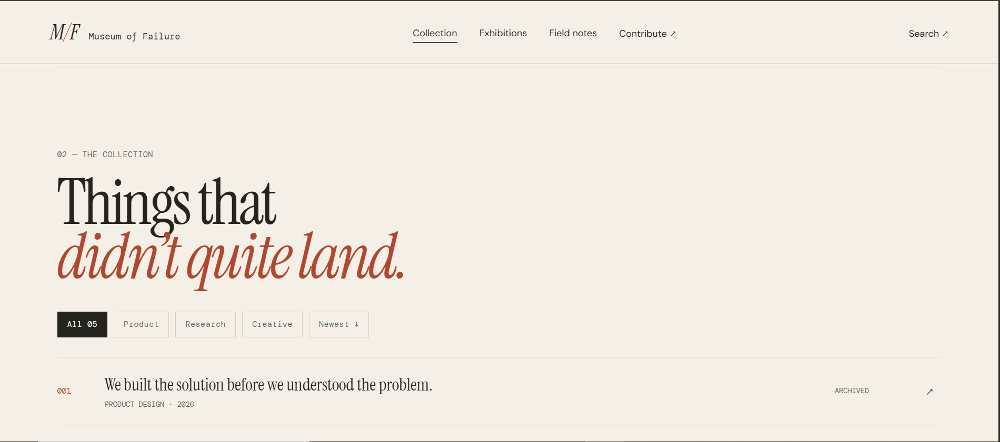
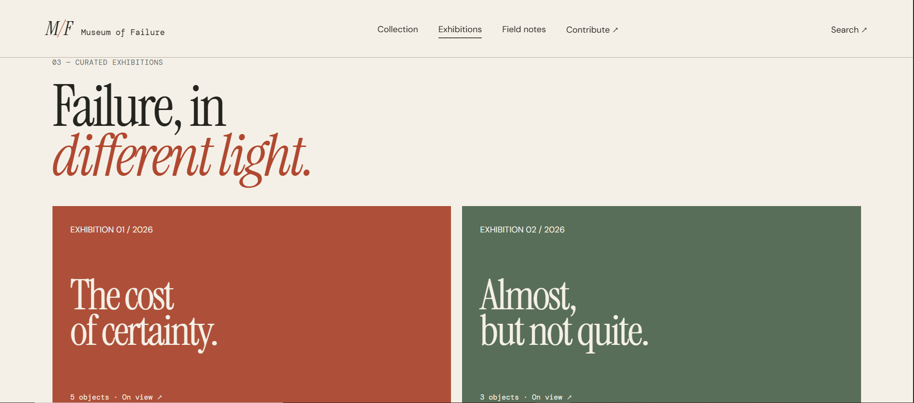
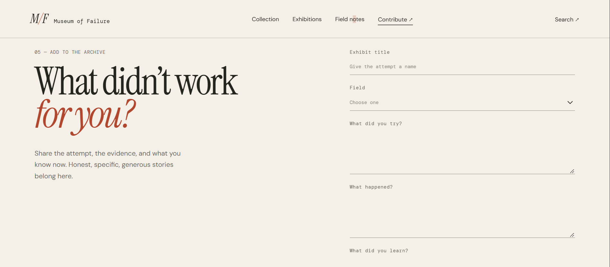

# 🏛️ Museum of Failure


**Museum of Failure** is a digital museum dedicated to the experiments that did not work, the ideas that never took off, and the projects that ended differently than expected.

It is an interactive archive where failed attempts are treated not as things to hide, but as experiences worth documenting, examining, and learning from.

Through curated exhibits, collection browsing, field notes, and visitor submissions, the museum explores the stories behind unsuccessful ideas and the lessons they leave behind.

**Because failure is not the opposite of progress. Sometimes, it is part of the process.**

---

## 📑 Table of Contents

- [The Museum Experience](#-the-museum-experience)
- [About the Project](#-about-the-project)
- [Features and Experiences](#-features-and-experiences)
- [Exhibition Sections](#-exhibition-sections)
- [How to Explore the Museum](#-how-to-explore-the-museum)
- [Built With](#️-built-with)
- [Getting Started](#-getting-started)
- [How to Use the Website](#-how-to-use-the-website)
- [The Museum's Philosophy](#-the-museums-philosophy)
- [Project Structure](#-project-structure)
- [Design Direction](#-design-direction)
- [Current Scope and Limitations](#️-current-scope-and-limitations)
- [Future Developments](#-future-developments)
- [Contributing](#-contributing)
- [License](#-license)
- [Creator](#-creator)

---

## 🖼️ The Museum Experience

The following screenshots provide a glimpse into the Museum of Failure's digital exhibition space.

<table>
  <tr>
    <td align="center" colspan="2">
      
      <br>
      <b>The Museum Entrance</b>
      <br>
      <sub>The main interface introduces the museum and its featured exhibit.</sub>
    </td>
  </tr>
  <tr>
    <td align="center">
      
      <br>
      <b>The Collection</b>
      <br>
      <sub>Browse the archive of documented failures.</sub>
    </td>
    <td align="center">
      
      <br>
      <b>The Exhibition</b>
      <br>
      <sub>Explore individual stories and their outcomes.</sub>
    </td>
  </tr>
  <tr>
    <td align="center">
      
      <br>
      <b>Field Notes</b>
      <br>
      <sub>Discover reflections and observations from the archive.</sub>
    </td>
    <td align="center">
      
      <br>
      <b>Contribute to the Museum</b>
      <br>
      <sub>Share a story that deserves to be documented.</sub>
    </td>
  </tr>
</table>

---

## 📌 About the Project

Failure is often treated as something embarrassing, something to avoid, or something that should be forgotten. Yet behind many unsuccessful attempts are valuable ideas, difficult decisions, unexpected discoveries, and lessons that can influence what happens next.

**Museum of Failure** was created around a simple idea: unsuccessful attempts deserve a place in the archive, too.

The website presents failure through the perspective of a digital museum. Rather than displaying traditional artworks or historical artifacts, it documents experiments, abandoned projects, unsuccessful products, rejected ideas, and unexpected outcomes.

Each exhibit is an opportunity to look beyond the result and understand the story behind it.

Visitors can explore the collection, discover curated exhibitions, read field notes, and submit their own experiences.

The project aims to create a thoughtful space where curiosity is encouraged, mistakes are acknowledged, and learning continues.

### Our Central Idea

> Not everything that fails is worthless. Some failures leave behind the most important lessons.

---

## ✨ Features and Experiences

Museum of Failure combines an editorial-style presentation with interactive museum-inspired features.

### 🏛️ Museum Entrance

- **Featured Exhibit** - Introduces a selected story from the museum's collection.
- **Editorial Hero Section** - Presents the museum's identity and central philosophy.
- **Curated Introduction** - Guides visitors into the experience of exploring documented failures.
- **Direct Exploration** - Provides access to the collection and other museum sections.

### 🗂️ The Collection

- **Exhibit Archive** - Browse documented experiments, projects, and unsuccessful ideas.
- **Category Filtering** - Narrow the collection using available exhibit categories.
- **Sorting Options** - Organize exhibits according to available sorting choices.
- **Exhibit Previews** - Review introductory information before opening a complete exhibit.
- **Individual Exhibit Details** - Explore the background, outcome, and lessons associated with an entry.

### 🖼️ Curated Exhibitions

- **Selected Collections** - Discover exhibits grouped around particular themes.
- **Exhibition Previews** - Explore curated selections beyond the main collection.
- **Story-Focused Presentation** - Experience documented failures through a museum-style layout.

### 🔎 Search Experience

- **Collection Search** - Find exhibits using relevant words or phrases.
- **Search Overlay** - Access the search experience without leaving the current page.
- **Faster Discovery** - Narrow down the collection and locate specific entries.

### 📝 Field Notes

- **Reflections and Observations** - Explore written thoughts related to failure, experimentation, and learning.
- **Editorial Content** - Present ideas and perspectives in a reading-focused format.
- **Additional Context** - Discover lessons that extend beyond individual exhibits.

### ✍️ Contribute to the Museum

- **Visitor Submissions** - Provide a way for visitors to share their own stories of failure.
- **Structured Submission Form** - Organize submitted information into relevant fields.
- **Local Submission Handling** - The current prototype stores submissions locally in the browser.
- **Community Participation** - Encourage visitors to contribute experiences worth documenting.

### 🎨 Interface and Usability

- **Editorial Museum Aesthetic** - A restrained design inspired by printed publications, archival collections, and exhibition catalogs.
- **Typography-Driven Layout** - Combines serif, sans-serif, and monospaced typography.
- **Responsive Design** - Adapts the interface to different screen sizes.
- **Interactive Details** - Includes hover effects, transitions, dialogs, and navigation interactions.
- **Accessible Interaction States** - Supports clearer interaction through focus and reduced-motion considerations.

---

## 🏺 Exhibition Sections

The museum is organized into several interconnected experiences.

| Section | Purpose |
|---|---|
| Museum Entrance | Introduces the museum, its purpose, and its featured exhibit. |
| Collection | Provides access to the archive of documented failures. |
| Exhibitions | Presents selected exhibits through curated thematic groupings. |
| Field Notes | Shares observations, reflections, and lessons about failure. |
| Search | Helps visitors find specific exhibits and stories. |
| Contribute | Allows visitors to submit experiences for consideration. |

Each section contributes to the museum's larger purpose: documenting what went wrong and understanding what can be learned from it.

---

## 🧭 How to Explore the Museum

The museum is designed to be explored at your own pace.

### 1. Enter the Museum

Begin at the main interface. Read the introduction and discover the featured exhibit to understand what the museum is about.

### 2. Browse the Collection

Navigate to the Collection section to explore the available entries.

You can use the available category filters and sorting controls to organize the exhibits.

### 3. Open an Exhibit

Select an exhibit to view its detailed information.

Take time to understand the background, the idea behind the attempt, what happened, and what can be learned from its outcome.

### 4. Discover Curated Exhibitions

Explore the curated exhibition previews to discover stories grouped around particular themes.

### 5. Read the Field Notes

Visit Field Notes for additional reflections and observations about experimentation, mistakes, and learning.

### 6. Search the Archive

Use the search feature to locate specific exhibits or topics within the available collection.

### 7. Contribute a Story

If you have an experience worth sharing, visit the contribution section and complete the submission form.

Your story may offer a lesson that someone else needs to hear.

---

## 🛠️ Built With

Museum of Failure uses web technologies to create an interactive and responsive museum experience.

### Frontend Development

- **HTML5** - Provides the structure and organization of the website.
- **CSS3** - Handles the visual presentation, layout, responsiveness, and transitions.
- **JavaScript** - Powers interactive features, navigation, filtering, searching, and exhibit interactions.

### Browser-Based Functionality

- **DOM Manipulation** - Updates and controls interactive website elements.
- **Local Storage** - Supports local persistence for visitor submissions in the current prototype.
- **Responsive CSS** - Adapts the interface to different screen sizes.
- **CSS Transitions and Animations** - Provide smoother visual interactions.

### Development Tools

- Visual Studio Code
- Git
- GitHub
- Modern Web Browser

---

## 🚀 Getting Started

Want to explore the project locally or work on its source code? Follow the instructions below.

### Prerequisites

Make sure you have the following:

- A modern web browser.
- Visual Studio Code or another code editor.
- Git (optional, for cloning the repository).
- A local development server or browser environment capable of serving the project files.

### 1. Clone the Repository

```bash
git clone https://github.com/rheillunio2-byte/Museum-of-Failure.git
```

### 2. Navigate to the Project Folder

```bash
cd Museum-of-Failure
```

### 3. Open the Project in Visual Studio Code

```bash
code .
```

Alternatively, open Visual Studio Code manually and select the project folder.

### 4. Run the Website

The project uses standard HTML, CSS, and JavaScript files.

You can open `index.html` directly in your browser or use a local development server.

If you use the Visual Studio Code Live Server extension:

1. Open the project folder.
2. Locate `index.html`.
3. Right-click the file.
4. Select **Open with Live Server**.
5. Your browser will open the local website.

### 5. Explore the Website

Once the website is running, navigate through the available sections and test the interactive features.

**Note:** The current project is a frontend prototype. Its contribution form uses browser-based local storage rather than a connected online database.

---

## 📖 How to Use the Website

### A. Navigating the Museum

Use the website's navigation to move between the main museum sections.

The interface is designed to provide a straightforward browsing experience without requiring visitors to create an account.

### B. Exploring Exhibits

1. Open the Collection section.
2. Browse the available exhibits.
3. Use the category filters to narrow the results.
4. Change the sorting option when needed.
5. Select an exhibit to open its detailed view.
6. Read the story and examine its documented outcome.

### C. Searching for an Exhibit

1. Open the search interface.
2. Enter a relevant keyword or phrase.
3. Review the matching entries.
4. Select an exhibit to explore its details.

### D. Reading Field Notes

1. Navigate to Field Notes.
2. Browse the available written entries.
3. Select or read the content provided.
4. Reflect on the observations and lessons presented.

### E. Submitting a Story

1. Navigate to the Contribute section.
2. Complete the available submission fields.
3. Review your information.
4. Submit your contribution.
5. Follow the interface feedback provided.

**Important:** In the current prototype, submissions are stored in the visitor's browser using local storage. They are not automatically sent to a central database or made publicly visible to other visitors.

---

## 🧠 The Museum's Philosophy

Museum of Failure is built around three ideas.

### 1. Document What Happened

Failure should not be reduced to a single label. Understanding an unsuccessful attempt requires looking at its context, decisions, circumstances, and outcome.

### 2. Find Meaning in the Outcome

An unsuccessful result can still provide useful information. It can reveal overlooked problems, challenge assumptions, and help people make better decisions in the future.

### 3. Keep the Lessons Alive

A documented failure can become a resource for someone else. Sharing experiences allows lessons to move beyond the person or project that originally encountered them.

The museum does not celebrate failure for its own sake. It recognizes the value of examining it honestly.

---

## 📂 Project Structure

```text
Museum-of-Failure/
│
├── images/
│   ├── Collection.PNG
│   ├── Contribute.PNG
│   ├── Exhibition.PNG
│   ├── Field Notes.PNG
│   └── Main UI.PNG
│
├── index.html
├── styles.css
├── app.js
│
├── README.md
├── CONTRIBUTING.md
├── LICENSE
└── .gitignore
```

### File and Folder Descriptions

| File / Folder | Purpose |
|---|---|
| `images/` | Contains screenshots and visual assets used in the project documentation. |
| `images/Collection.PNG` | Screenshot of the museum's collection interface. |
| `images/Contribute.PNG` | Screenshot of the visitor contribution section. |
| `images/Exhibition.PNG` | Screenshot of the exhibition experience. |
| `images/Field Notes.PNG` | Screenshot of the Field Notes section. |
| `images/Main UI.PNG` | Screenshot of the main museum interface. |
| `index.html` | Main HTML document and website structure. |
| `styles.css` | Contains the website's styling, layout, responsive behavior, and transitions. |
| `app.js` | Handles interactive functionality and browser-side behavior. |
| `README.md` | Project overview, features, setup instructions, and documentation. |
| `CONTRIBUTING.md` | Guidelines for contributing to the project. |
| `LICENSE` | Contains the project's license. |
| `.gitignore` | Specifies files and folders excluded from Git tracking. |

---

## 🎨 Design Direction

The Museum of Failure follows an editorial and archival visual direction.

Its interface is designed to feel more like a thoughtfully curated publication or museum catalog than a conventional web application.

### Visual Identity

- **Warm Paper Backgrounds** - Create an archival and print-inspired atmosphere.
- **Ink-Inspired Typography** - Establish a clear visual hierarchy and reading experience.
- **Restrained Accent Colors** - Add visual emphasis without overwhelming the interface.
- **Serif Typography** - Gives exhibit titles and editorial content a distinctive character.
- **Sans-Serif Typography** - Keeps interface labels and supporting text readable.
- **Monospaced Typography** - Supports archival labels, metadata, and technical details.

### Design Principles

- Prioritize readability and content.
- Use whitespace intentionally.
- Keep navigation straightforward.
- Make exhibits feel like individual archival records.
- Use animation to support interaction, not distract from it.
- Maintain a consistent visual language across all sections.
- Preserve the existing layout and design identity when improving the website.

---

## ⚠️ Current Scope and Limitations

Museum of Failure is currently a frontend-focused digital museum prototype.

The following limitations apply to the current implementation:

- The website does not currently require visitor authentication.
- Contribution submissions are stored locally in the browser.
- Visitor submissions are not automatically synchronized across devices.
- There is no connected central database for managing contributions.
- Submitted stories are not automatically published to the public collection.
- The available exhibits and field notes depend on the content included in the project.
- Search, filtering, and sorting operate within the available collection data.
- The project does not currently provide a full content-management system.
- Browser storage may be cleared by the visitor or browser settings.

These limitations describe the current prototype and may change as the project develops.

---

## 🔮 Future Developments

The Museum of Failure can grow beyond its initial prototype.

Possible future improvements include:

- **Centralized Exhibit Database** - Store and manage exhibits through a connected database.
- **Submission Management System** - Allow administrators to review and organize visitor contributions.
- **Curator Dashboard** - Provide tools for managing exhibits, categories, and field notes.
- **Visitor Accounts** - Introduce optional accounts for contributors.
- **Advanced Search** - Support more detailed filtering and search options.
- **Expanded Archive** - Include more stories from different industries, communities, and disciplines.
- **Exhibit Timeline** - Present the development and eventual outcome of selected projects chronologically.
- **Community Contributions** - Create a structured process for reviewing and publishing submitted stories.
- **Accessibility Improvements** - Continue improving keyboard navigation, screen-reader support, and interface accessibility.
- **Enhanced Mobile Experience** - Refine interactions and layouts for smaller devices.

These are potential developments and are not necessarily part of the current version.

---

## 🤝 Contributing

Every museum grows through the stories, perspectives, and work of the people who help build it.

Contributions to Museum of Failure are welcome, whether they involve improving the website, fixing bugs, refining the interface, updating documentation, or suggesting new ways to present failure and learning.

Please read [CONTRIBUTING.md](CONTRIBUTING.md) before submitting changes.

---

## 📄 License

Museum of Failure is distributed under the **MIT License**.

See the [MIT License](https://github.com/rheillunio2-byte/Museum-of-Failure?tab=MIT-1-ov-file) for the applicable terms and conditions.

---

## 👨‍💻 Creator

**Rheil Evans T. Lunio**

GitHub: [@rheillunio2-byte](https://github.com/rheillunio2-byte)

---

<p align="center">
  <b>Museum of Failure</b>
  <br>
  <i>An archive of what did not work, and what it taught us.</i>
</p>
